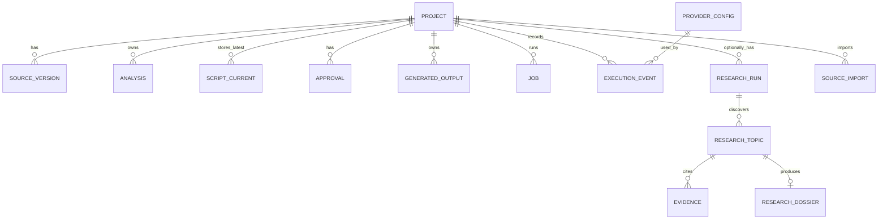

# Data Model and Relationships — Conceptual Specification

This is a conceptual schema, not a claim that these tables already exist. Choose implementation-level types in P03 and record them in migrations.

## Required logical records

### Project
`project_id`, name/title, `created_at`, `updated_at`, status, ratio, duration settings, content language, thumbnail text language (where separate), preferred provider/model, settings version/hash.

### Source version
`source_id`, `project_id`, `source_version`, title, source type, optional URL, saved content or content reference, status, created/updated timestamps, content hash, analysis status.

### Analysis
Analysis type (`source` or `script`), input version/hash, output payload/reference, status, model/provider provenance if appropriate, timestamps. Reuse only when input hash/version and dependent settings match the analysis validity policy.

### Latest script
One current record per project (or one current pointer plus replaceable content record); content, hash/version, generated timestamp, validation report, source version used, relevant settings snapshot/hash. No script history table.

### Approval
Project ID, current script hash/version, settings hash/version, approver/action, timestamp, approval validity. Any mismatch means approval is invalid.

### Generated outputs
Kind (`video_prompt`, `thumbnail_prompt`, `seo_package`, and future research dossier/import metadata), input version references, settings hash, content, validation report, freshness status, creation timestamp.

### Job and execution event
Job ID, project ID, skill ID, status, input reference/hash, provider/model, attempt count, timestamps (start/finish), duration/latency (ms), normalized/sanitized error, usage metrics (tokens in/out/total) if available, fallback request/permission/result. Strictly metadata only; do not store secrets, and strictly do not persist raw prompts, raw source text, or raw LLM request/response payloads (DEC-018). Retention is strictly capped at latest 100 records per project with FIFO pruning.

### Research entities (Module E)
Research run scope, connector statuses, candidate topic/rank/score explanations, evidence URLs/titles/publication/retrieval timestamps/source type, dossier claims and citations, optional source import link. Preserve source-specific limits and retrieval status.

## Data integrity rules

- Every project-owned query must include/verify `project_id`.
- Unique ID and referential integrity for project-linked rows.
- Enforce maximum four active saved projects in a transaction (DEC-019), including concurrent creation attempts.
- Do not store prior script versions; only preserve a prior candidate in transient memory/temp storage during validation if needed, then discard after safe replacement.
- Enforce maximum 100 execution history records per project; inserting a 101st record must automatically FIFO-prune the oldest execution record for that project (DEC-018).
- Persist metadata only in execution history; schema must forbid columns or payloads for raw prompts, raw source text, or raw LLM request/response bodies (DEC-018).
- Project deletion must cascade to remove linked project rows, project-specific execution history records (DEC-018), files, caches and temp files.
- Environmental safety invariant: Project deletion, data cleanup, or execution history pruning operations must NEVER delete or modify the shared `.env` file under any circumstance (DEC-018).
- Export excludes all secret values.
