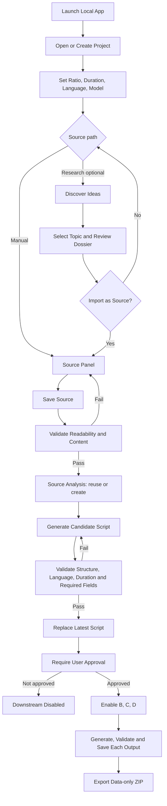

# End-to-End Sequence, States and Invalidation

## Main user path

## Core states

- Source: `Unsaved`, `Saved`, `Changes Not Saved`, `Validated`, `Failed`, `Unreadable`.
- Job: `Queued`, `Running`, `Validating`, `Completed`, `Failed`, `Cancelled`.
- Analysis: `Not Started`, `Valid`, `Stale`, `Failed` (exact enum implementation to confirm).
- Script approval: `Not Approved`, `Approved`; approval must reference script hash/version and relevant settings.
- Research connector: `Not Configured`, `Available`, `Fetching`, `Retrieved`, `No Results`, `Rate Limited`, `Restricted`, `Failed`.

## Invalidation matrix

| Changed item | Must invalidate or re-check |
|---|---|
| Source content/version | Source Analysis, current script as applicable, Script Analysis, approval, B/C/D outputs as applicable |
| Script content/version/hash | Script Analysis, approval, video prompts, thumbnail prompt, SEO |
| Aspect ratio | Any dependent prompts; revalidate/regenerate B and C at minimum |
| Content language | Script/voiceover and thumbnail text; revalidate outputs; SEO remains Roman Hindi |
| Duration/part plan | Script structure/duration and video prompts; revalidate downstream dependencies |
| Preferred model | Future execution routing; existing validated outputs need not automatically become stale unless output provenance policy says so |
| Research source selection/window/region | New Research Run; do not mutate an old dossier silently |

Exact dependency rules must be encoded centrally and covered by tests, not duplicated in UI code or prompts.
