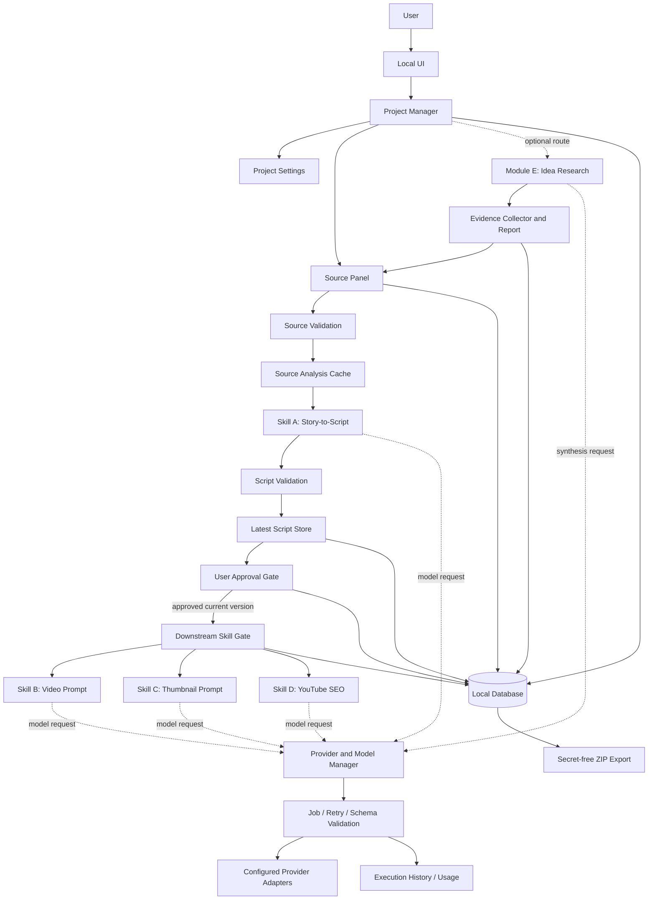

# Master Architecture

## System diagram



## Architectural boundaries

- **Presentation layer:** Local UI only; no skill business logic hidden in UI handlers.
- **Application/use-case layer:** project lifecycle, source workflow, approvals, generation orchestration, export/deletion.
- **Domain layer:** project, source/script versions, approvals, job states, stale dependencies, duration/language validation.
- **Skill adapters:** protected contracts for Skills A–D; Module E is optional and separate.
- **Provider layer:** one common interface, tested provider adapters, capability/model metadata and normalized errors.
- **Persistence layer:** local database and filesystem; project-scoped queries must enforce `project_id`.
- **Configuration/security layer:** `.env` for local developer mode; no secret in Git or normal logs; optional secure OS keyring is a future/approved implementation choice.

## Proposed local repository layout

```text
ai-studio/
  app/
    ui/
    routes_or_views/
    use_cases/
    domain/
    persistence/
    services/
    providers/
    skills/
      story_to_script/
      script_to_video/
      thumbnail/
      youtube_seo/
      idea_research/        # optional Module E
    jobs/
    security/
  migrations/
  tests/
    unit/
    integration/
    acceptance/
  docs/
  data/                    # local; ignored by Git
  exports/                 # local; ignored by Git
  logs/                    # local; ignored by Git
  .env.example
  .env                     # never commit
  .gitignore
  requirements.txt or pyproject.toml
  run.bat
  README.md
```

The stack choice (UI framework, database ORM, migration library, test runner, packaging tool) is a Phase P00 decision; do not infer it from this diagram. Prefer the simplest local stack that supports all explicit behaviors and is recorded in the decision register.

## Main dependency sequence

1. Requirements/contracts and acceptance inputs.
2. Repository/runtime.
3. Configuration and secret handling.
4. Domain models/database/migrations.
5. Project manager and settings.
6. Provider interface and first tested adapter.
7. Jobs, error handling, usage and history.
8. Source panel and validation.
9. Analysis cache, invalidation and approval.
10. Skill A, then B, then C, then D.
11. Export/security/deletion/full integration.
12. Optional Module E.
13. Regression, clean install, packaging/release.

## Must-not-cross boundaries

- Provider manager does not author skill logic.
- A URL string is not evidence that content was retrieved.
- Trend rank is not factual confidence.
- User selection is required before importing research as the main source.
- Local `.env` plain text must not be described as encrypted.
- No feature may be marked done without tests/evidence.
