# AI Studio — Detailed Master Plan & System Blueprint

**Source:** `01_MASTER_PLAN(1).md` — Approved Product Requirements  
**Purpose of this document:** Original master plan ko detail mein samjhana, uske core rules, subsystems, workflows, state changes, diagrams aur implementation constraints ko ek jagah organize karna.  
**Important:** Yeh source plan ka detailed explanation hai, approved scope ko expand karne ki permission nahi. Jahan original plan kisi implementation detail ko specify nahi karta, wahan use **“Abhi define nahi hai / implementation decision pending”** mark kiya gaya hai.

---

## 0. Executive takeaway

AI Studio ek **project-based application** hai jo chaar distinct AI skills ko ek controlled workflow mein chalata hai:

1. **Story-to-Script** — user ke source se fact-grounded script.
2. **Script-to-Video Prompt Engineering** — approved script ke har part ke liye video-generation prompt; actual video nahi.
3. **AI Thumbnail Intelligence Engine** — poore approved script se ek thumbnail image-generation prompt; actual image nahi.
4. **YouTube SEO Engine** — project-aware metadata package; SEO language hamesha Roman Hindi.

Ek shared **AI Provider & Model Manager** requests ko provider/model tak route karta hai, lekin skill ki reasoning, rules ya output contract ko replace nahi karta.

System ke sabse important guardrails:

- Source save aur validate hue bina script generation nahi.
- Current script approve hue bina downstream skills nahi chal sakte.
- Script edit/regeneration par validation aur fresh approval mandatory.
- Sirf latest script save hoti hai; script history nahi.
- Source/script/settings change hone par dependent analysis aur outputs stale mark hote hain.
- Preferred model fail hone par user permission ke bina alternative model nahi.
- Maximum 6 active projects; seventh ke liye oldest project delete karne ki explicit confirmation.
- API keys aur secrets export, client bundle, URL ya logs mein kabhi nahi.
- Requirement ya technical conflict par guess nahi karna; issue ko surface karke user se decision lena.

---

# 1. Master architecture diagram

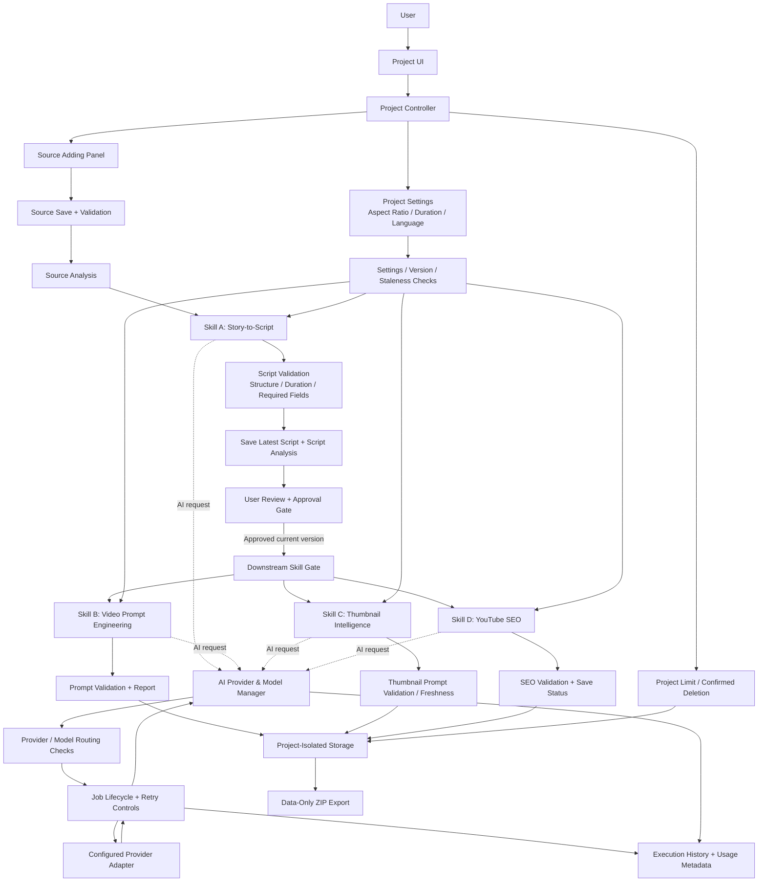

### 1.1 Diagram ko kaise samjhein

- **Project UI / Controller**: project create/open karna, settings save karna, allowed actions enable/disable karna.
- **Settings**: aspect ratio, duration aur content language ka source of truth.
- **Source Panel**: source material collect, edit, save aur validate karta hai.
- **Skills A–D**: har skill apne protected instructions aur input/output contract ke mutabik kaam kare.
- **Approval Gate**: current script version approved hone par hi downstream skills unlock hote hain.
- **Model Manager**: request execution route karta hai; skill logic khud nahi banata.
- **Job Lifecycle**: queued/running/validating/completed ya failed/cancelled state ko track karta hai.
- **Project-Isolated Storage**: alag-alag projects ke data ko separate rakhta hai.
- **Export / Delete / History**: data export, deletion aur safe execution audit ke liye alag responsibilities.

---

# 2. Four skills — contract, input/output aur sub-diagrams

## 2A. Skill A — Story-to-Script

### Purpose
User-supplied source material se **fact-grounded script** banana. Source pasted text, article, URL, transcript, synopsis, story, research, history, biography ya business case ho sakta hai—lekin sirf utna hi, jitna actual reader/access capability support kare.

### Input
- Saved source content.
- Source title/type aur optional URL.
- Project language.
- Aspect ratio aur requested duration/part constraints.
- Existing source analysis, agar us source version ke liye valid ho.

### Core logic
1. Confirm karo ki usable source content maujood aur validated hai.
2. Source ke facts aur context ko analyze karo; jahan possible ho, claims ko source se traceable rakho.
3. Source type ke hisaab se angle choose karo.
4. Story flow, parts aur requested duration plan karo.
5. Project content language ke mutabik script likho.
6. Structure, duration aur required fields validate karo.
7. Sirf targeted corrections karo; unsupported facts invent mat karo.
8. Internal analysis ko final user-facing script ke roop mein galti se mat dikhao.
9. Script aur relevant analysis ko current script version ke saath save karo.
10. User review aur approval ka wait karo.

### Output structure
Har part mein zaroori fields:
- Part Number
- Type: Hook / Story / Ending
- 8-second Hindi VO jahan applicable ho; language project selection ke mutabik honi chahiye
- Visual suggestions
- On-screen text

Hindi project mein script/voiceover Devanagari mein; English project mein English mein.

### Sub-diagram
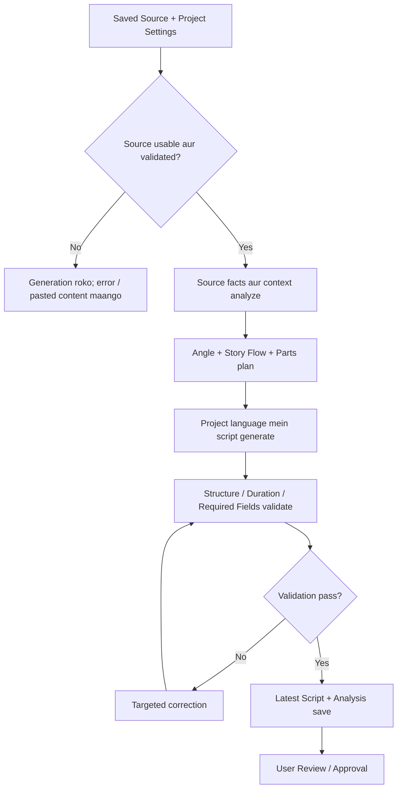

### Failure / restrictions
- URL stored hona content read hone ka proof nahi.
- URL access fail ho toh reason batana aur pasted source maangna.
- Unsupported facts, events ya claims invent nahi karne.
- Original skill ka full prompt ek protected contract hai; summary us prompt ko replace nahi karti.

---

## 2B. Skill B — Script-to-Video Prompt Engineering

### Purpose
Current **approved final script** aur project settings se har script part ka detailed video-generation prompt banana. Yeh skill prompts banata hai—actual videos nahi.

### Prompt mein consider hone wale elements
- Part ka action aur script ke facts
- Scene aur timeline
- Camera
- Lighting
- Visual style
- Audio
- Continuity
- Constraints
- Aspect ratio
- Voiceover/content language

### Core logic
1. Current approved script aur settings load karo.
2. Confirm karo ki approval current script version/hash aur settings se match karta hai.
3. Valid Script Analysis saved hai toh reuse karo; bina wajah dobara analysis mat chalao.
4. Har part ke liye script meaning preserve karte hue prompt banao.
5. Unsupported events, people ya facts add mat karo.
6. Project aspect ratio aur language validate karo.
7. Prompt(s) aur validation report existing skill contract ke mutabik return/save karo.

### Sub-diagram
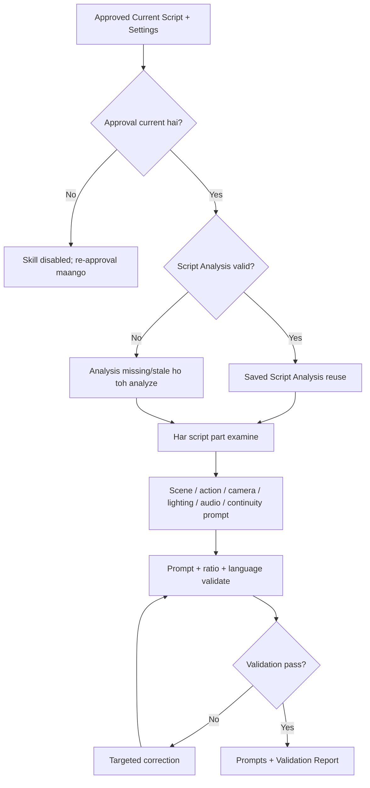

### Restrictions
- Script ki meaning ko badalna nahi.
- Unsupported people/events/facts invent nahi karne.
- Project aspect ratio aur language ke rules follow karne.
- Valid Script Analysis ko unnecessarily re-run nahi karna.

---

## 2C. Skill C — AI Thumbnail Intelligence Engine

### Purpose
Project thumbnail ke liye **ek complete image-generation prompt** produce karna. Yeh skill khud image generate nahi karta.

### Primary input
Poora current approved final script—sirf hook ya ek isolated part nahi.

### Core logic
1. Current approved script aur relevant project settings read karo.
2. Poore topic/story ka analysis karo.
3. Strong lekin truthful thumbnail angle select karo.
4. Prompt mein subject, composition, background, lighting, style aur zarurat par optional text describe karo.
5. Aspect ratio aur thumbnail text language apply karo.
6. Ek current thumbnail prompt per project store karo.
7. Script/settings badalne se dependent prompt stale ho toh regenerate/revalidate karo.

### Sub-diagram
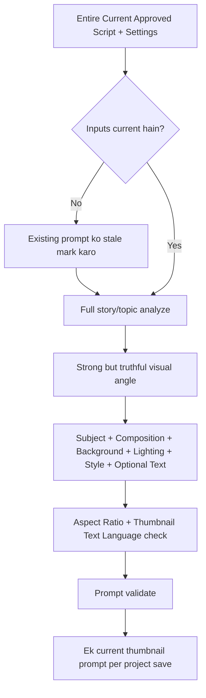

### Restrictions
- Poore approved script ko primary input rakhna.
- Misleading visual claims nahi.
- Output ek complete prompt hai, image file nahi.

---

## 2D. Skill D — YouTube SEO Engine

### Purpose
Source aur approved script context se project-aware SEO package banana.

### Required output fields
- Title
- Description
- Keywords
- Hashtags
- Separate comma-separated tags field

### Core logic
1. Project ID/version, current script aur source context load karo.
2. Valid Source Analysis aur Script Analysis reuse karo.
3. Analysis/output version freshness check karo.
4. Claims ko source/script ke against reconcile karo.
5. Saare SEO outputs Roman Hindi mein likho—Latin alphabet mandatory.
6. Disclosure sirf tab add karo jab content/use case mein warranted ho.
7. Package aur uski status project ke saath save karo.

### Sub-diagram
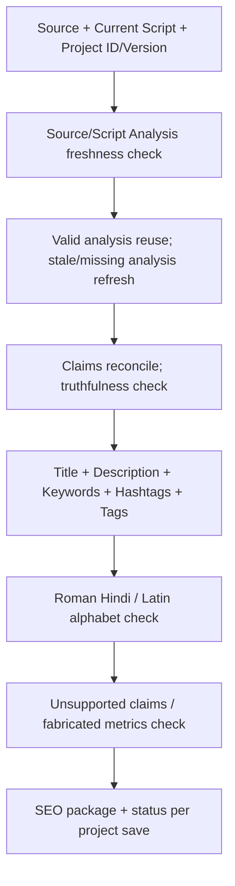

### Restrictions
- SEO output ki language always Roman Hindi.
- Search volume fabricate nahi karna.
- Ranking guarantee nahi deni.
- Unsupported claims nahi.
- Disclosure har case mein automatic nahi; sirf warranted hone par.

---

# 3. Project creation aur settings logic

## 3.1 New project workflow

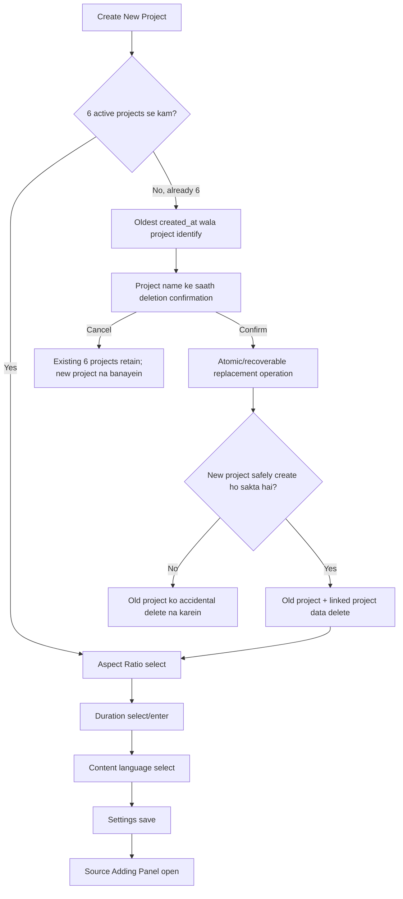

**Interpretation:** Deletion ko pehle irreversible tareeke se execute kar dena aur baad mein new project banana safe nahi. Plan ke mutabik operation atomic/recoverable hona chahiye, taaki failure se unintended data loss na ho.

## 3.2 Allowed settings

| Setting | Approved option / rule | Required effect |
|---|---|---|
| Aspect ratio | `9:16` portrait | Target 1080×1920 |
| Aspect ratio | `16:9` landscape | Target 1920×1080 |
| Content language | Hindi | Script/VO Devanagari; thumbnail text Hindi/Devanagari |
| Content language | English | Script/VO English; thumbnail text English |
| SEO language | Fixed | Roman Hindi, Latin alphabet—project language se independent |
| Reopen project | Existing saved settings restore | Har baar project settings dobara poochne ki zaroorat nahi |
| New project | Settings selection required | Har new project par settings phir choose hongi |

Technical video prompts English ho sakte hain; voiceover phir bhi selected project language follow karega. Skills settings ko silently override nahi kar sakte.

## 3.3 Duration rules — exact constraints

### Vertical `9:16`

| Total | Parts | Exact structure |
|---:|---:|---|
| 24 sec | 3 | Hook + Story 1 + Ending |
| 32 sec | 4 | Hook + Story 1 + Story 2 + Ending |
| 40 sec | 5 | Hook + Story 1 + Story 2 + Story 3 + Ending |
| 48 sec | 6 | Hook + Story 1 + Story 2 + Story 3 + Story 4 + Ending |
| 56 sec | 7 | Hook + Story 1 + Story 2 + Story 3 + Story 4 + Story 5 + Ending |

Vertical parts 8 seconds ke hain. Extra 60-second option add karna approved nahi hai.

### Landscape `16:9`
- Minimum total duration: 180 seconds / 3 minutes.
- User minutes enter karta hai; hours input convenience ke roop mein tabhi ho sakta hai jab same rule preserve ho.
- Har part ka duration `> 0` aur `<= 8` seconds.
- Requested total ko exactly match karne ka aim; where possible exact.
- 180 sec example: 22 × 8 sec + 1 × 4 sec = 23 parts.

Har generated video prompt aur thumbnail prompt mein selected ratio explicitly respected hona chahiye. API aspect ratio parameter support karti ho toh woh bhi set ho. Ratio change par dependent outputs stale aur revalidation/regeneration-required honge.

---

# 4. Source Adding Panel aur source validation

## 4.1 Panel fields / actions

| Item | Requirement |
|---|---|
| Source type | Supported choices implementation capability ke mutabik: pasted text, URL, article, transcript, etc. |
| Source Title | Field |
| Source URL | Optional field |
| Main Source Content | Field |
| Actions | Save Source, Edit Source, Clear Unsaved Text |
| Status | Unsaved / Saved / Changes Not Saved / Validated / Failed or Unreadable |

## 4.2 Source status workflow

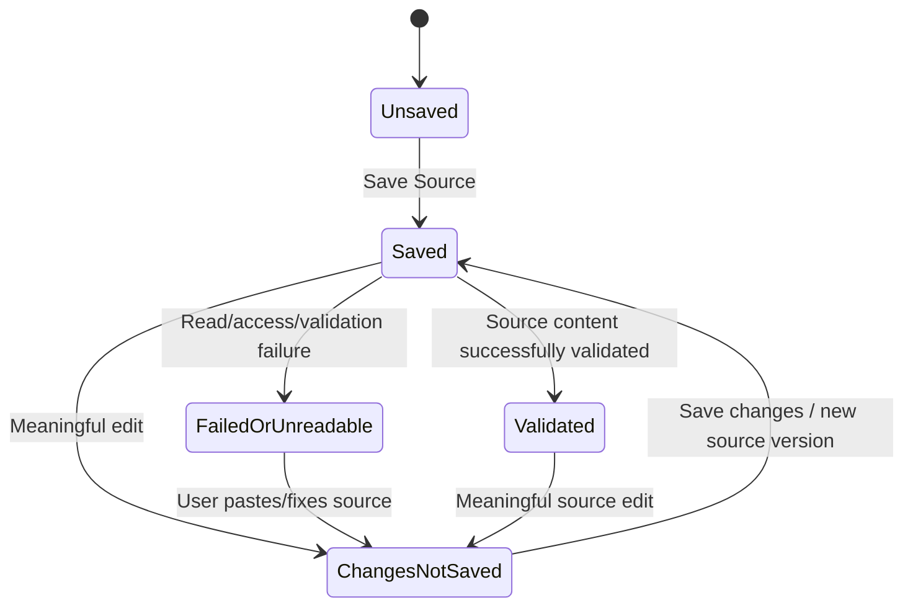

Status labels source document ke approved status vocabulary ko reflect karte hain. Exact validation algorithm, URL-reader technology aur specific failure taxonomy source plan mein define nahi hain.

## 4.3 Key source rules
- Script generation tab tak unavailable rahegi jab tak source saved aur validated na ho.
- Saved URL ka matlab yeh nahi ki URL content fetch/read ho gaya.
- URL access fail ho toh clear error aur manual paste ka option.
- Meaningful source edit par `source_version` increment hota hai.
- New source version save hoti hai; source analysis aur dependent outputs stale mark hote hain.

### Example source record from the plan
```json
{
  "project_id": "project-unique-id",
  "source_id": "source-unique-id",
  "source_version": 1,
  "source_title": "User supplied title",
  "source_type": "pasted_text",
  "source_url": null,
  "source_content": "User's saved source content",
  "source_status": "saved",
  "analysis_status": "not_started"
}
```

---

# 5. Versioning, freshness aur dependency invalidation

## 5.1 Analysis reuse rules

| Artefact | Generate / reuse rule |
|---|---|
| Source Analysis | Har source version ke liye ek baar; valid rahe toh reuse |
| Script Analysis | Current script version ke liye ek baar; valid rahe toh reuse |
| Video Prompt skill | Valid Script Analysis reuse kare |
| SEO skill | Valid Source Analysis aur Script Analysis reuse kare |
| Thumbnail prompt | Current approved full script aur settings par dependent; stale ho toh regenerate/revalidate |

Reanalysis sirf tab: analysis missing, invalid/stale, underlying input changed, ya user explicitly re-analysis maange.

## 5.2 Invalidation diagram

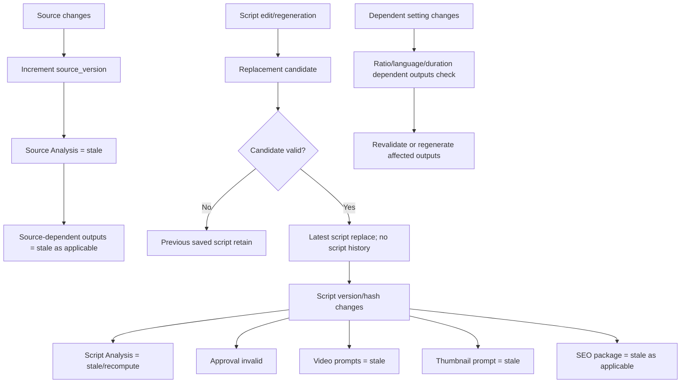

## 5.3 Script storage and approval invariants
- Latest script only; past script versions are not retained as project history.
- Candidate ko validate karne se pehle current script overwrite nahi karni.
- Validation fail ho toh previous saved script remain kare.
- Every edit/regeneration requires fresh approval.
- Downstream actions current approval ke bina disabled.
- Approval exact script version/hash plus relevant project settings se tied hai.
- Source change se source analysis aur dependent outputs stale hote hain; script change se script-related outputs aur approval invalid hote hain.

**Important distinction:** Source version history is explicitly required; script history is explicitly not allowed. Dono ko ek jaisa implement nahi karna.

---

# 6. Approval-gate logic

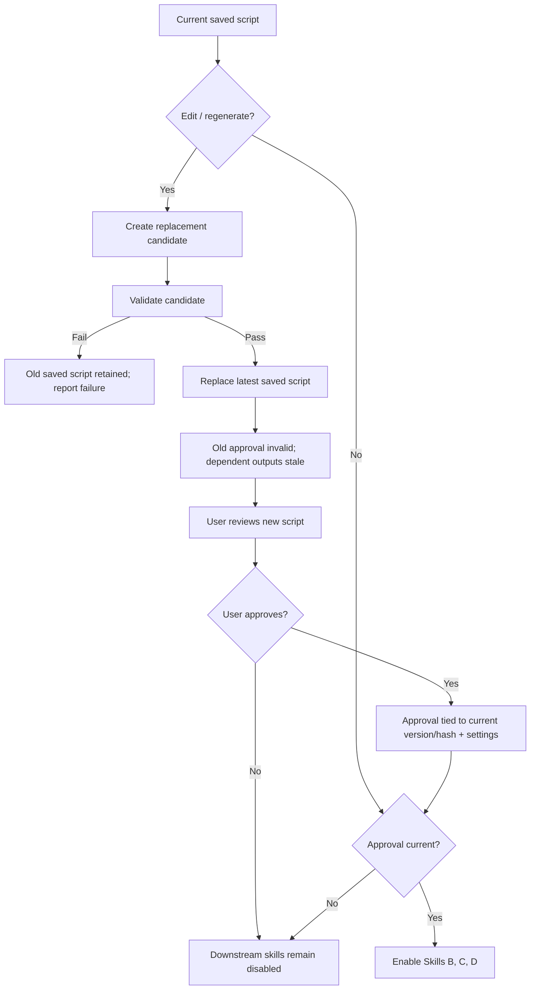

Approval sirf “project approved” ek generic boolean nahi honi chahiye; plan ke mutabik exact script version/hash aur relevant settings se linked honi chahiye. Specific hash algorithm/schema plan mein defined nahi hai.

---

# 7. AI Provider & Model Manager — request routing

## 7.1 Manager ki boundary
Manager request routing, provider integration aur operational controls karta hai. Yeh four skills ke domain instructions ko replace ya reinterpret nahi karta.

Candidate provider examples: Google Gemini, OpenAI, Groq, OpenRouter, Mistral, NVIDIA, DeepSeek, custom compatible providers. Yeh list existing support ka evidence nahi hai.

## 7.2 Provider adapter ke concepts
- Connection validate karna.
- Model listing, jahan supported ho.
- Known model capabilities expose karna.
- Request execute karna.
- Provider errors normalize karna.
- Usage/quota collect karna sirf jab exposed ho.
- Model catalogue data ka source aur last-checked date record karna, jab static/documented fallback use ho.

Provider/model ko `Supported` tabhi label karo jab adapter implemented **aur tested** ho. Unknown metadata `Unknown` hi rahe. Catalogue mein model hona access guarantee nahi karta—account, region, key aur plan restrictions apply ho sakti hain.

## 7.3 Routing diagram

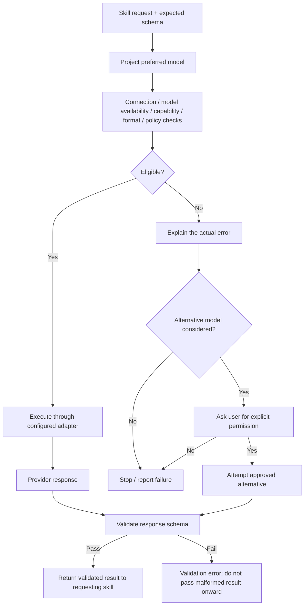

## 7.4 Model fallback, retry aur precedence
- Project-level model choice us project ke liye precedence rakhta hai.
- Unapproved per-skill model-routing complexity add nahi karni.
- Preferred model fail ho toh alternative use karne se pehle user permission lo.
- Safe transient failures par bounded retry, appropriate hone par same model ke saath.
- Invalid keys, access/region/plan errors, billing errors, aur model-not-found errors ko blindly retry nahi karna.
- Rate-limit/reset instructions provider ke mutabik respect karo.
- Timeout ke baad provider request complete kar chuka ho sakta hai; duplicate expensive generation se bachne ki koshish karo.
- Response ko skill tak bhejne se pehle expected schema validate karo.
- Sanitized execution metadata record karo; secret logs mein nahi.

---

# 8. Job lifecycle, progress aur retry controls

## 8.1 Required lifecycle

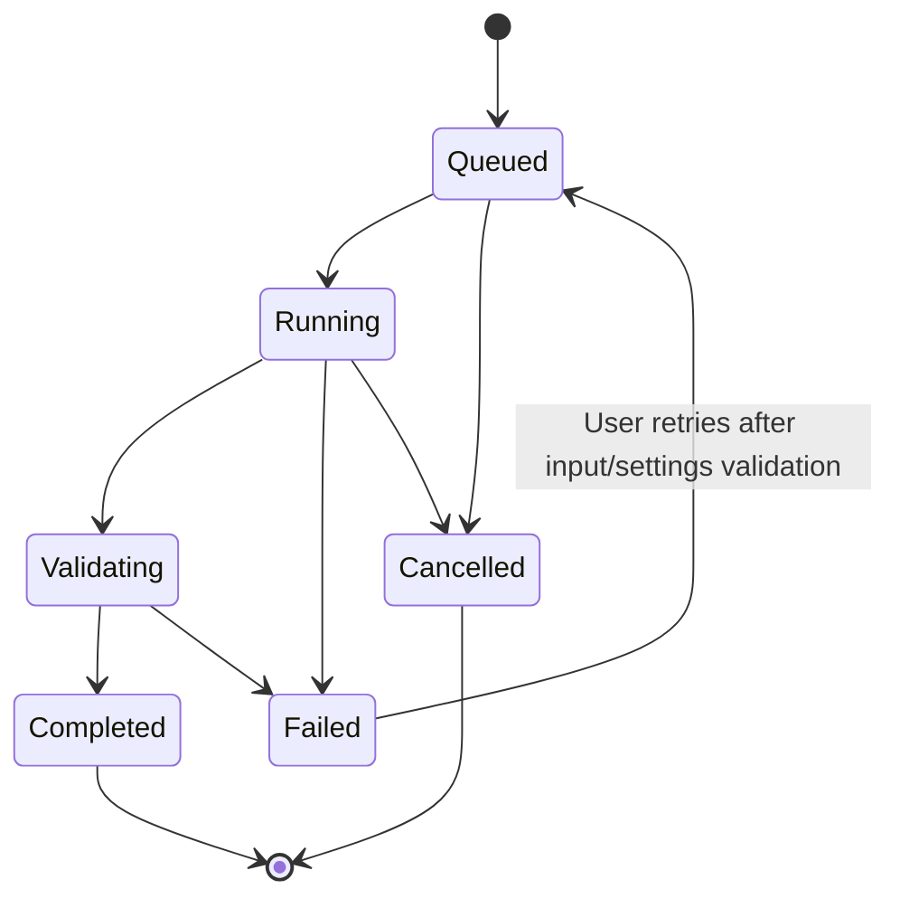

## 8.2 Job rules
- Status truthful ho; fake percentage ya fake activity animation nahi.
- Architecture support kare toh job state page reload ke baad survive kare.
- Same operation ke liye duplicate Generate clicks/jobs prevent karo.
- Failure par understandable reason aur Retry action show karo.
- Retry se pehle saved input aur settings validate karo.
- Naye output ke validate hone tak existing saved output retain karo.
- Alternative provider/model ke liye user permission required.
- Timeout handling aisi ho ki already completed provider request galti se repeat na ho.

**Abhi define nahi hai:** Exact queue technology, worker count, maximum retry count, timeout durations, job table schema aur numeric progress calculation. Plan sirf truthful progress, bounded safe retry aur duplicate-job prevention ki requirement deta hai.

---

# 9. Project data model aur isolation

## 9.1 Required per-project data
Har project ka unique `project_id` aur isolated store hona chahiye. Plan ke mutabik persist ki jaane wali information:
- Source content aur source version history.
- Source Analysis aur uska validity/status.
- Latest script aur Script Analysis.
- Current script approval status aur version/hash linkage.
- Video prompts.
- Thumbnail prompt.
- SEO package.
- Project settings.
- Skill/project statuses.
- Relevant execution metadata.

## 9.2 Conceptual relationship diagram

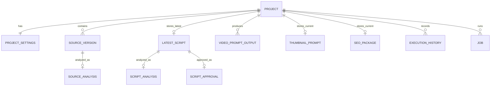

Yeh diagram **conceptual** hai: original plan exact SQL tables, storage engine ya ORM schema prescribe nahi karta. Ismein `LATEST_SCRIPT` ek hi current saved script ko represent karta hai; script history intentionally nahi hai. `SOURCE_VERSION` multiple versions support karta hai.

## 9.3 Isolation rules
- Har project ke content/outputs ko unique project ID ke saath link karna.
- Database aur application logic dono mein project boundaries enforce karna.
- Ek project ka source, analysis, script, output ya settings doosre project se accidentally reuse na ho.
- Shared provider credentials/settings project deletion ke saath delete nahi honge, jab tak explicitly project-scoped na hon.

---

# 10. Project limit aur deletion

## Exact rule
- Maximum **6 active saved projects**.
- Seventh create karne se pehle `created_at` se oldest identify karo.
- User ko project ka naam bata kar confirmation maango.
- Cancel: sabhi 6 projects retain; new project create nahi.
- Confirm: oldest project aur uska linked project data delete karke fresh ID ke saath new project create karo.
- Manual delete bhi confirmation maangta hai.
- In-app restore nahi hai; deletion permanent hai.
- Operation atomic/recoverable hona chahiye—failure par accidental loss nahi.
- Exported ZIP app ke bahar user ke control mein rehti hai.
- Shared credentials deletion se bachengi, jab tak project-scoped na hon.

### Deletion sub-diagram
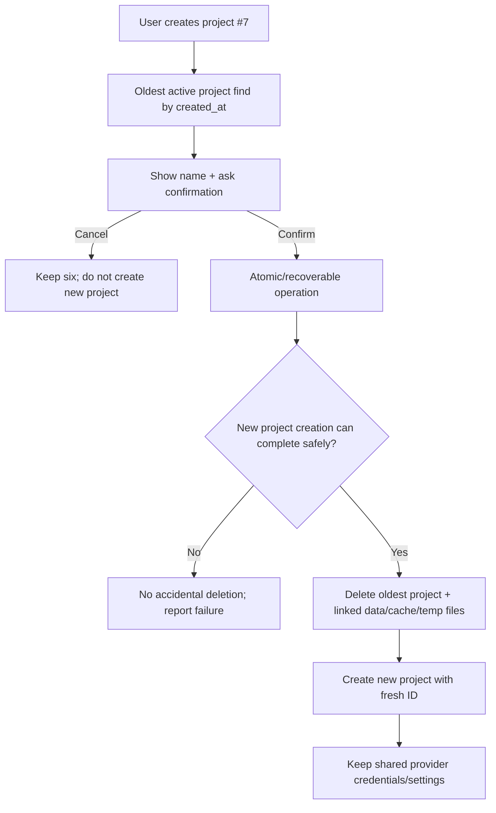

---

# 11. Usage tracking aur execution history

## Usage fields / display rules
- Provider/model requests aur token counts, jab available hon.
- Actual cost sirf reliably supplied ho toh actual ke roop mein.
- Cost reliably available na ho toh `Estimate` ya `Unknown` label.
- Usage limits/warnings configurable ho sakti hain.
- Provider quota/reset details sirf official endpoint/headers se exposed hon toh; anyatha `Unknown`.

## Execution history fields
- Project ID
- Skill ID
- Provider/model
- Timestamps
- Status
- Attempt number
- Sanitized error
- Usage data
- Fallback reason

Secrets aur unnecessary sensitive prompt content logs/history mein store nahi karna.

---

# 12. Security, secrets aur export

## 12.1 API-key security requirements
- API keys server-side encrypted store hon—example technology AES-256-GCM.
- Master encryption key database ke bahar, environment/secret manager mein.
- Initial submission ke baad frontend ko full saved secret dobara expose na ho; UI mask kare.
- Keys client bundle, URL, logs, export ZIP ya ordinary project data mein nahi.
- HTTPS, access control, redaction, key rotation aur disconnect controls required.
- Minimum necessary project data store karo.
- Temporary files tasks ke baad clean karo.
- Execution history retention configurable ho.

`AES-256-GCM` source document mein example hai (“e.g.”); exact deployed encryption architecture ka proof nahi.

## 12.2 Export diagram

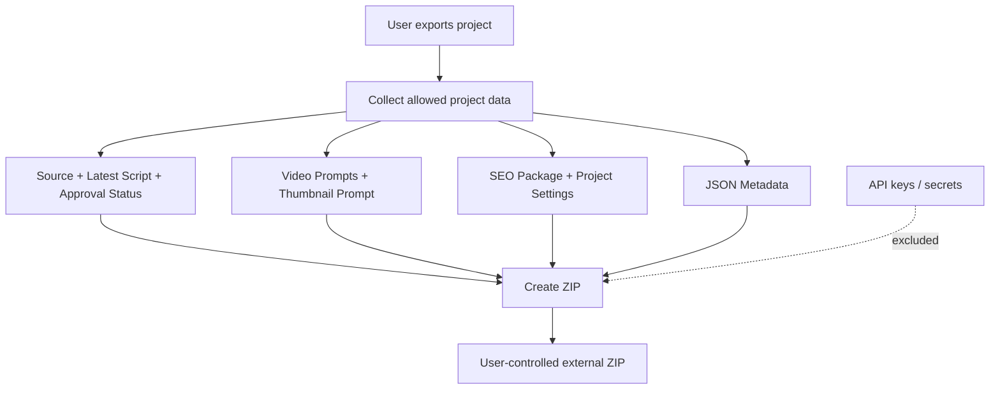

ZIP includes:
- Source
- Latest script
- Approval status
- Video prompts
- Thumbnail prompt
- SEO package
- Project settings
- JSON metadata

ZIP excludes API keys/secrets. Export is **data-only**. Import/restore feature approved nahi hai; use add nahi karna jab tak explicit approval na mile.

## 12.3 Deletion cleanup
Project deletion par linked project data, caches aur temporary files permanently remove hon. Shared provider credentials/settings tab tak safe rahen jab tak unka scope specifically project-level na ho.

---

# 13. Functional responsibilities — logical modules

**Note:** Neeche module names requirements ko explain karne ke liye conceptual groupings hain; original plan in exact software function names, API endpoints ya class names ko prescribe nahi karta.

| Logical module | Responsibility / checks | Plan se directly required? |
|---|---|---|
| Project lifecycle | Create/open project; six-project limit; confirmation/deletion; fresh project ID | Haan, behavior required; exact function names nahi |
| Project settings | Aspect ratio, duration, language save/restore; dependent outputs ko stale mark karna | Haan |
| Source management | Save/edit/clear; source type/title/URL/content; source version increment; status | Haan |
| Source validator/reader | Confirm usable content; URL read/access failure report; paste fallback | Haan; specific parser/provider define nahi |
| Source Analysis manager | Source version ke liye analysis reuse; stale/missing par reanalyze | Haan |
| Story-to-Script skill | Facts/context, angle, structure, script generation, script validation | Haan |
| Script version/approval manager | Candidate validation, latest-only replacement, approval hash/version, gate downstream actions | Haan |
| Script Analysis manager | Current script version ki analysis reuse/invalidate | Haan |
| Video prompt skill | Per-part prompts, constraints, ratio/language checks, validation report | Haan |
| Thumbnail skill | Whole-script analysis, one prompt, aspect/text language, stale status | Haan |
| SEO skill | Project-aware metadata, Roman Hindi, truthfulness, freshness, save status | Haan |
| Provider/model catalog | Connections, model catalog, capability metadata, status `Supported` only after testing | Haan |
| Provider adapter | Execute call, normalize errors, usage collection where exposed | Haan, adapters only where implemented/tested |
| Routing/fallback controller | Preferred model routing; alternative permission; safe bounded retries | Haan |
| Job controller | Lifecycle, truthful progress, duplicate-job prevention, retries, reload persistence where supported | Haan |
| Usage/history tracker | Sanitized execution metadata, usage, costs/quotas labelled accurately | Haan |
| Export service | Required data in ZIP; secrets excluded | Haan |
| Security/secret storage | Server encryption, masked secret, no secret leakage, access controls | Haan |
| Acceptance test suite | Execute test matrix; require evidence before completion | Haan |

---

# 14. End-to-end lifecycle — all major gates together

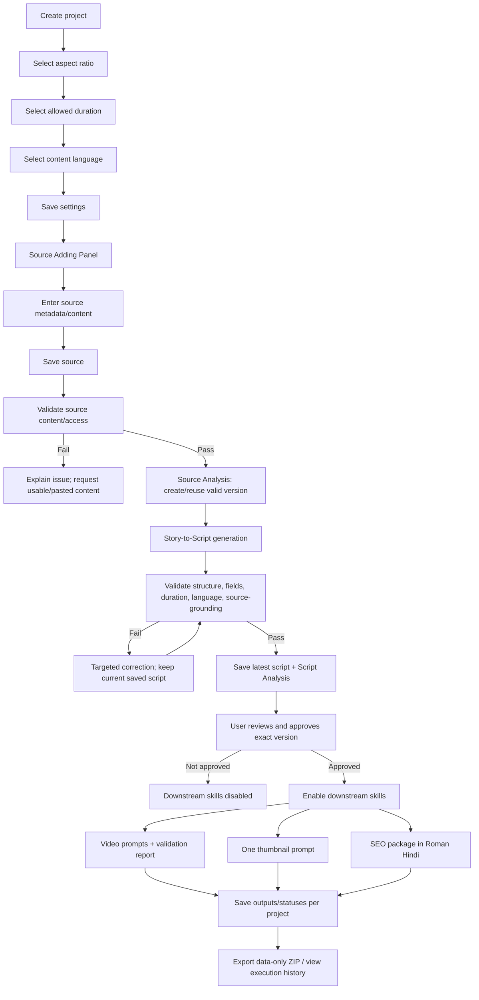

---

# 15. Validation matrix — what must be checked

| Area | Required validation / invariant |
|---|---|
| Source | Content usable and saved; URL access not assumed; unreadable source gives error and paste option |
| Script | Source-grounded; correct language; required fields; valid part structure and duration |
| Vertical duration | Only 24/32/40/48/56 seconds; exact approved part pattern; 8 seconds per part |
| Landscape duration | Total at least 180 seconds; each part >0 and <=8 seconds; total matched where possible |
| Approval | Exact current script version/hash and relevant settings; edits invalidate approval |
| Replacement | Candidate passes validation before replacing latest script; failed candidate preserves prior saved script |
| Video prompts | Preserve script facts/meaning; check aspect ratio, language, continuity and constraints; return validation report |
| Thumbnail | Full script primary input; exactly one prompt; truthful angle; ratio and text language respected |
| SEO | Required metadata fields; Roman Hindi; no fabricated search volumes/ranking guarantees/unsupported claims |
| Provider/model | Connection, model availability, capability, output format and policy checks; actual tested support only |
| Fallback | No alternative model without explicit permission |
| Retry | Bounded safe transient retries; no blind retry on credential/access/billing/model errors |
| Jobs | Accurate lifecycle/progress; duplicate jobs prevented; prior outputs preserved until replacement validates |
| Project isolation | All content and outputs scoped by project; enforced in DB/application logic |
| Project limit | Max 6 active; confirm oldest deletion before seventh; safe atomic/recoverable operation |
| Security | No secrets in frontend/logs/URLs/export; encrypted server-side storage; masked key display |
| Export | Required project artefacts included; secrets excluded; no restore behavior implied |
| Deletion | Linked data/cache/temp files removed; shared credentials retained unless project-scoped |
| Delivery | Test matrix run; no completion claim without evidence |

---

# 16. Failure scenarios and required system response

| Scenario | Expected response from approved plan |
|---|---|
| URL cannot be read | Explain why; ask user to paste source content; do not pretend it was read |
| Source not saved/validated | Disable script generation |
| Script candidate fails validation | Keep previously saved script; report problem; do not overwrite |
| Script is edited/regenerated | Invalidate prior approval and affected outputs; require new approval |
| Current script not approved | Disable downstream skills |
| Preferred model fails | Notify user; ask permission before alternative model |
| Invalid key / access / billing / model-not-found | Do not blindly retry |
| Safe transient provider error | Bounded retry of same model may be appropriate |
| Provider timeout | Consider whether request may have completed; avoid duplicate costly operation where possible |
| AI response schema invalid | Do not pass invalid result to skill; treat as a validation failure |
| Cost/quota not exposed | Show `Estimate` or `Unknown` as appropriate; do not fabricate actual values |
| Seventh project cancelled | Keep all six; don't create new project |
| New-project operation fails | No accidental deletion/data loss |
| Export requested | Export approved data; never include secrets; no restore feature implied |
| Requirement conflict / technical inability | Stop and ask user; don't guess |

---

# 17. What is explicitly not approved / what must not be assumed

1. **No unapproved functionality** or silent behavior changes.
2. No extra vertical durations such as 60 seconds.
3. No script-history storage; latest script only.
4. No unapproved restore/import feature for project export ZIPs.
5. No silent fallback to an alternate model.
6. No unsupported factual claims, fabricated search metrics, or guaranteed SEO rankings.
7. No claim that a provider/model is supported without implemented and tested adapter evidence.
8. No guessed model metadata, account access, cost, quota or reset information.
9. No claim that original skill contracts are embedded until the authoritative original prompts are obtained and stored as protected, versioned contracts.
10. No “feature complete” claim without acceptance-test evidence.

---

# 18. Dependencies, gaps and implementation decisions still open

These are not new features; they are limits or unresolved points visible in the approved master plan.

### Explicit dependencies
- The complete authoritative original prompts for all four skills were not included in the current plan file. They must be imported before asserting the exact original instructions are embedded.
- Acceptance testing must use `09_TEST_AND_ACCEPTANCE_MATRIX.md`. That file is referenced by the plan; its contents are not present in this master-plan text.

### Details the plan does not define
- Exact database schema, storage technology and API endpoint names.
- Exact algorithm for URL extraction, source readability and validation.
- Exact analysis object schema and how source claims are linked/cited internally.
- Exact hash algorithm and approval data schema.
- Exact queue/worker architecture, retry count, timeout duration and numeric progress design.
- Exact provider adapters that will be implemented, unless separately tested and documented.
- Exact model-catalog refresh schedule beyond retaining source/last-checked metadata for static fallbacks.
- Exact cost estimation formula when provider cost is not reliably available.

Where these choices are required for implementation, they should be resolved without violating the approved behaviors and should be recorded through the project's decision register/changelog when they affect requirements.

---

# 19. Acceptance and release principle

The plan requires the implementation to be tested against `09_TEST_AND_ACCEPTANCE_MATRIX.md`. A feature is not complete merely because a UI button exists or a happy-path demo works; completion needs evidence. Tests should cover the valid path and important failure/edge cases in Section 15–16, particularly:

- version invalidation and approval gates,
- duration/part validation,
- provider errors and non-silent fallback,
- safe retry and duplicate job prevention,
- six-project limit and atomic deletion,
- secret exclusion from logs/export,
- project isolation,
- export contents,
- stale-output handling.

The precise test cases, expected assertions and evidence format must come from the referenced acceptance matrix and approved implementation decisions—not be invented and represented as if they were already in that file.

---

# 20. Final mental model

Is system ko ek pipeline samjhein, jiske beech mein teen control gates hain:

1. **Source gate:** source saved + validated ho tabhi script generation.
2. **Script approval gate:** current script validated + user-approved ho tabhi video, thumbnail aur SEO downstream skills.
3. **Execution/security gate:** provider/model checks, schema validation, truthful job states, safe retries aur secret protection har AI request par.

Project versioning batata hai ki kaunsa output ab bhi valid hai; project isolation batata hai ki data kis project ka hai; approval gate batata hai ki downstream work allowed hai ya nahi; model manager batata hai ki request kis configured model ko safe tareeke se bheji ja sakti hai. Export aur deletion ko project data lifecycle ke disciplined parts ke roop mein handle kiya jata hai.

**Bottom line:** AI Studio ka core product sirf chaar prompt-generating skills nahi hai. Yeh project state, version validity, source truthfulness, human approval, controlled model routing, security aur acceptance evidence se governed workflow hai. In controls ko preserve karna plan ka sabse important requirement hai.
