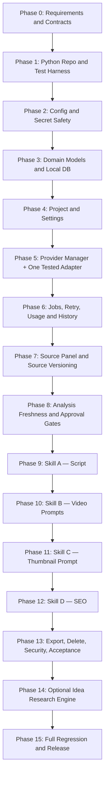
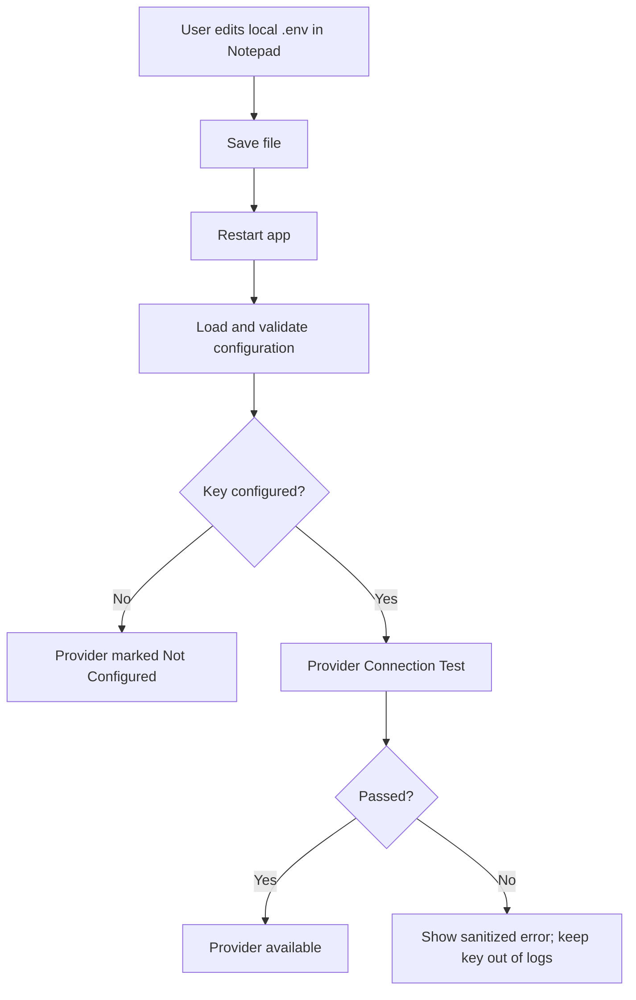

# AI Studio — Build Order & Implementation Roadmap

**Purpose:** Is document ka kaam sirf feature list dena nahi hai. Yeh batata hai ki AI Studio ko actual coding mein **kis order mein build karna hai, har phase se pehle kya ready hona chahiye, kaun se tests pass hone chahiye, aur next phase kab shuru karna safe hai**.

**Planning basis:**
- Original `01_MASTER_PLAN(1).md` — approved product requirements.
- `AI_Studio_Master_Plan_Detailed_Hinglish.md` — architecture/system explanation.
- Later discussion — local Python installation, GitHub repository, local `.env` configuration, and optional Idea Research & Discovery Engine.

**Important status label:** Jahan `REQUIRED` likha hai, woh original plan ka existing rule hai. Jahan `PROPOSED AMENDMENT` likha hai, woh baad ki discussion se aaya hai aur final baseline mein add karne se pehle Decision Register mein approve kiya jaana chahiye. Jahan `OPEN DECISION` likha hai, original plan exact implementation specify nahi karta.

---

# 0. Executive decision: build in dependency order, not feature order

AI Studio ko ek saath poora generate/build nahi karna. Har phase ka output run hona chahiye, uske automated/manual tests pass hone chahiye, aur phase ki evidence save honi chahiye. Tabhi next phase start ho.

## 0.1 Recommended build sequence

1. Requirements freeze aur missing authoritative files collect karna.
2. Local Python repository skeleton, environment aur test runner.
3. Config validation, local secrets handling aur safe logging.
4. Domain models, local database aur migrations.
5. Project management aur settings.
6. AI Provider & Model Manager ka interface, phir ek provider adapter end-to-end test.
7. Job lifecycle, retry, status, usage aur execution history.
8. Source panel, source validation aur source versioning.
9. Analysis freshness/invalidation aur script approval gates.
10. Skill A — Story-to-Script.
11. Skill B — Script-to-Video Prompt Engineering.
12. Skill C — Thumbnail Intelligence.
13. Skill D — YouTube SEO.
14. Export, deletion cleanup, security hardening aur acceptance matrix completion.
15. Optional Module E — Idea Research & Discovery Engine.
16. Final regression, local installation test, optional executable packaging aur release.

> Research module ko chaar core skills se pehle build nahi karna. Pehle direct source → approved script → downstream outputs ka stable basic path pass hona chahiye. Research baad mein isi Source Panel ko source content dega.

## 0.2 Master build-order diagram



The exact calendar/time estimates are intentionally omitted. Phase completion depends on test evidence, not a date.

---

# 1. Phase 0 — Requirements freeze and decision register

**Goal:** Coding se pehle decide karna ki system exactly kya karega. Is phase ko skip karne se baad mein architecture rewrite aur conflicting behavior ka risk hota hai.

## 1.1 Required inputs

- [ ] Original Master Plan, current approved version.
- [ ] Chaar original protected skill prompts/contracts, authoritative source se.
- [ ] `09_TEST_AND_ACCEPTANCE_MATRIX.md` ki authoritative copy.
- [ ] Current detailed architecture summary.
- [ ] Proposed local-deployment amendment.
- [ ] Proposed Idea Research module amendment.

**BLOCKER:** Original skill prompts current Master Plan file set mein included nahi the. Exact original contract embedded hone ka claim tab tak nahi karna jab tak full prompts import, version aur test na ho jaayen.

**BLOCKER:** Original plan `09_TEST_AND_ACCEPTANCE_MATRIX.md` ka reference deta hai. Agar file available nahi hai, toh pehle authoritative copy locate karein. Interim tests ban sakte hain, par unhein original acceptance matrix ka replacement kehkar present na karein.

## 1.2 Decision Register — implementation se pehle

| ID | Decision | Recommended baseline | Status |
|---|---|---|---|
| D-001 | Deployment | Local Python application; public hosting required nahi | Proposed amendment — approve and record |
| D-002 | UI shape | Localhost browser UI, backend/UI separation | Open decision; framework lock before scaffolding |
| D-003 | Local data | Local database + project-specific files | Proposed amendment; exact DB technology open |
| D-004 | API keys | `.env` for developer mode; never commit secrets | Proposed amendment |
| D-005 | Non-technical key management | Optional later UI + OS credential store | Optional; not required for first local prototype |
| D-006 | Initial provider | One real, tested adapter first; Groq may be first if approved/configured | Open decision |
| D-007 | Skill routing | Project-level preferred model; no silent model fallback | Required by original plan |
| D-008 | Research mode | Optional pre-source module; direct source workflow remains available | Proposed amendment |
| D-009 | Research source access | Connector adapters based on actual permitted access; no fake coverage | Proposed amendment |
| D-010 | Research ranking | Explainable score; weights approved before real ranking claims | Open decision |
| D-011 | Research model | Existing project-preferred model by default; no unapproved per-skill routing | Recommended to preserve original plan |
| D-012 | Packaging | Python local run first; executable only after regression is stable | Recommended sequence |
| D-013 | OS target | Windows-first install test, given current local-install use case; other OS only when approved | Proposed default |

## 1.3 Exit gate — Phase 0 complete only when

- [ ] Full protected prompts are present and versioned.
- [ ] Acceptance matrix is present or a clearly labelled interim matrix is recorded.
- [ ] Existing requirements and proposed amendments are separated.
- [ ] UI framework, initial database and initial provider decisions are recorded.
- [ ] Unknowns and intentionally deferred features are visible.
- [ ] No conflict is silently resolved by the developer.

**Do not implement the AI skill prompts before this gate passes.** Basic repository scaffolding can follow once these inputs and decisions are under control.

---

# 2. Phase 1 — Repository skeleton and repeatable Python setup

**Goal:** Ek clean repository jo har baar predictable tareeqe se install aur run ho.

## 2.1 Proposed starting repository

```text
ai-studio/
├── README.md
├── pyproject.toml                 # Project/package metadata and tool config
├── requirements.txt or lock file  # Exact dependency strategy must be consistent
├── .env.example                   # Placeholder keys only
├── .env                           # Local secrets; never commit
├── .gitignore
├── run.bat                        # Optional Windows launcher
├── src/
│   └── ai_studio/
│       ├── __init__.py
│       ├── main.py                # Application entry point
│       ├── bootstrap.py           # Startup checks / dependency wiring
│       ├── config/
│       ├── core/
│       ├── db/
│       ├── projects/
│       ├── sources/
│       ├── analysis/
│       ├── approvals/
│       ├── providers/
│       ├── jobs/
│       ├── skills/
│       ├── research/              # Optional phase, later
│       ├── export/
│       └── ui/
└── tests/
    ├── unit/
    ├── integration/
    ├── contract/
    ├── acceptance/
    └── fixtures/
```

Yeh initial structure suggestion hai, final enforced folder scheme nahi. Important rule: UI, core business logic, provider adapters aur storage logic ko ek hi file mein mix nahi karna.

## 2.2 Is phase ke tasks

1. Git repository aur main branch setup.
2. Python virtual environment create karne ka repeatable process.
3. Dependencies ko ek consistent file/lock strategy mein pin karna.
4. `main.py` se minimal application start karna.
5. `pytest` ya selected test runner configure karna.
6. Formatter/linter/type-check configuration select karna.
7. `.env.example` aur safe `.gitignore` banana.
8. README mein local install/run/test steps likhna.

## 2.3 Basic tests

- Fresh clone se environment setup documented steps se work kare.
- App command se predictable startup ho.
- Test runner ek sample test pass kare.
- Missing dependency/config par understandable error aaye.
- `.env`, DB, logs, exports aur temporary user data galti se Git tracking mein na aayein.

## 2.4 Exit gate

**Fresh clone → environment setup → test run → application start** ek clean machine/environment par successfully repeat ho.

---

# 3. Phase 2 — Configuration, `.env` and secret safety

**Goal:** App ko startup par configuration validate karni aani chahiye, bina secrets leak kiye.

## 3.1 Configuration design

- `.env.example` mein blank/placeholder values.
- `.env` local-only, `.gitignore` mein ignored.
- Config loader startup par values read kare.
- Missing optional provider key se app crash na ho.
- Required config missing ho toh clear startup/feature-specific error.
- API keys logs, UI error details, test snapshots, project JSON ya exports mein na aayein.
- `.env` badalne ke baad v1 mein application restart required ho sakta hai; live reload alag approved feature hoga.

Example values (placeholders only):

```dotenv
AI_STUDIO_ENV=local
AI_PROVIDER=groq
GROQ_API_KEY=
DEFAULT_MODEL=
DATABASE_URL=
```

Names ko actual adapter aur chosen database ke mutabik final karna hoga. Empty API key ka matlab connector configured nahi, na ki fabricated default key.

## 3.2 Add/remove key workflow



Deleting a key from `.env` only removes the local configuration entry. Provider-side key revocation must still be done from the provider account dashboard when required.

## 3.3 Security tests

- Git status/commit check confirms `.env` is not tracked.
- Test logs and error messages do not contain a fake test secret.
- Export fixture never includes provider secrets.
- Missing key is displayed as `Not Configured`, not a confusing crash.
- Bad key error is surfaced without retry loops.

## 3.4 Exit gate

Configuration handling must be repeatable and secrets must stay out of Git, logs, UI-visible raw errors and export.

---

# 4. Phase 3 — Domain models, local database and migrations

**Goal:** UI ya AI skill banane se pehle data ki authoritative shape define karna.

## 4.1 Core entities to model

- Project
- ProjectSettings
- Source and SourceVersion
- SourceAnalysis
- LatestScript / ScriptVersionIdentifier
- ScriptAnalysis
- ScriptApproval
- VideoPromptOutput
- ThumbnailPromptOutput
- SEOPackageOutput
- Job and JobAttempt
- ProviderExecutionRecord / UsageRecord
- ResearchRun / CandidateTopic / Evidence / ResearchReport (later module)

The data structures must make project isolation explicit. Har project-linked row/record ko correct `project_id` se associate hona chahiye.

## 4.2 Required domain invariants

- Unique project ID.
- Six active saved project maximum.
- Source versions retained.
- Only latest script persisted; no script history feature.
- Script approval tied to exact script hash/version and applicable settings.
- Source/script/settings changes invalidate dependent analysis and outputs.
- Jobs have valid lifecycle state.
- Secrets are not stored in project data.

## 4.3 Database work

1. Chosen local database configure karein.
2. Initial schema/migrations create karein.
3. Repositories/data-access layer implement karein.
4. Transaction boundaries define karein.
5. DB version/migration strategy document karein.
6. Test fixtures aur temporary test DB setup karein.

## 4.4 Basic tests

- Project create/read/update/delete at repository layer.
- Project A ka data Project B se query na ho.
- Unique IDs and required fields enforce hon.
- Migration empty DB se current schema tak run kare.
- Invalid state changes rejected hon.
- Secrets project records mein persist na hon.

## 4.5 Exit gate

Data model aur invariants automated tests se protected hon. Is phase ko pass kiye bina skills ki output persistence implement na karein.

---

# 5. Phase 4 — Project manager and project settings

**Goal:** User ko project create karna, reopen karna aur approved settings restore karna reliably work kare.

## 5.1 Project creation form

- Project name/title.
- Aspect ratio: `9:16` or `16:9`.
- Content language: Hindi or English.
- Duration according to aspect ratio rules.
- Preferred provider/model and alternatives supported by the manager.
- Save settings before source generation workflow opens.

## 5.2 Exact duration validation

**9:16:** only 24, 32, 40, 48, 56 seconds. Parts respectively 3, 4, 5, 6, 7; every part 8 seconds; structure Hook + Story parts + Ending.

**16:9:** minimum 180 seconds; user inputs minutes (hours may be input convenience only if same rule holds); every part `0 < duration <= 8 seconds`; match total exactly where possible.

## 5.3 Project-limit behavior

- If fewer than six active projects exist: create normally.
- If there are six: identify oldest by `created_at`, show its name, request confirmation.
- Cancel: preserve all six and do not create new project.
- Confirm: safe/atomic/recoverable transition; remove old project and linked data, then create a new ID.
- If new project creation can fail, do not start irreversible deletion until operation can complete safely.
- Shared provider credentials remain when a project is deleted unless explicitly project-scoped.
- Manual deletion requires confirmation.

## 5.4 Basic UI tests

- Valid/invalid settings combinations.
- Reopen restores exact saved settings.
- Invalid vertical duration is blocked.
- Landscape duration and part generation rules checked.
- Six-project boundary and confirm/cancel behavior.
- Deletion failure does not cause unexpected data loss.

## 5.5 Exit gate

Project CRUD, settings, duration rules and active-project limit pass before adding the AI skills UI.

---

# 6. Phase 5 — AI Provider & Model Manager

**Goal:** Skills ke independent prompts/code ko AI provider calls se safely connect karne ka shared layer.

## 6.1 Build in smaller sub-steps

### 6A. Provider interface first

Define common operations without tying skill logic to one vendor:

- Validate connection.
- List models when supported.
- Report known capabilities and output-format support.
- Execute a request with timeout.
- Normalize provider errors.
- Expose usage/quota only where provider makes it available.

### 6B. One real adapter end-to-end

- First select the initial provider in the decision register. Groq is a possible first adapter, not automatically the only provider.
- Add one adapter.
- Test connection and a small harmless request using environment-provided key.
- Verify output schema behavior and actual error normalization.
- Verify no key is printed to logs.

### 6C. Model catalog and routing

- Use official list API when supported.
- Otherwise use documented/static fallback with source and last-checked metadata.
- Unknown capability stays `Unknown`.
- Catalog visibility does not mean the account/region/plan/key can access it.
- Project preferred model takes precedence.
- Alternatives may be tried only after explicit user permission.
- No unapproved per-skill routing complexity.

## 6.2 Normalized errors

At minimum distinguish:

- Invalid/missing credentials.
- Access/region/plan denied.
- Billing/quota issue.
- Rate limit and reset time when known.
- Model not found/unavailable.
- Timeout/network error.
- Invalid response/schema.
- Provider server error.

Do not retry invalid key, access/region/plan, billing or model-not-found blindly. Bounded retry is only for appropriate transient failures.

## 6.3 Tests

- Missing key → correct status.
- Invalid key → one clear failure, no retry loop.
- Valid key + model → provider request succeeds.
- Unknown capability stays unknown.
- Preferred-model failure never silently routes to alternative.
- Alternative requires explicit permission.
- Provider response normalized before reaching a skill.
- Secret not present in logs/errors/history.

## 6.4 Exit gate

One provider is fully connection-tested, response-schema-tested and secret-safe. Add more providers only through the same interface and adapter tests.

---

# 7. Phase 6 — Jobs, progress, retry, usage and execution history

**Goal:** AI requests have a reliable lifecycle before long-running skills are added.

## 7.1 Required lifecycle

`Queued → Running → Validating → Completed`

Terminal alternatives: `Failed` or `Cancelled`.

## 7.2 Job controls

- Real status/progress, never invented percentage or fake animation.
- Prevent duplicate Generate clicks/jobs for the same operation.
- Persist job state across reloads where supported by selected architecture.
- Give understandable failure reason and Retry action.
- Validate saved input/settings before retry.
- Keep previous outputs until replacement validates.
- Avoid duplicate expensive requests after uncertain timeouts.
- Do not change to alternative model without explicit permission.

## 7.3 Usage and audit history

Record where available:

- Project ID and skill ID.
- Provider and model.
- Start/end timestamps and status.
- Attempt number.
- Sanitized error and fallback reason.
- Token counts/usage and reliable cost.
- Quota/reset only when exposed by provider.

Label cost as `Estimate` or `Unknown` when actual cost is not reliably available. Do not log keys or unnecessary sensitive prompt content.

## 7.4 Tests

- Every legal status transition and illegal transition.
- Duplicate generation blocked.
- Timeout does not blindly duplicate an expensive operation.
- Retry allowed only for appropriate failure categories.
- Old output preserved when job fails.
- Job status visible after page reload if persistence is supported.
- Usage/history contains no secret.

## 7.5 Exit gate

A fake/test job and a real small provider job both go through lifecycle correctly before skill pipelines are implemented.

---

# 8. Phase 7 — Source Adding Panel and validation

**Goal:** Stable main-source workflow, which both direct user input and later Idea Research import will use.

## 8.1 Source panel fields/actions

- Source Title.
- Source URL (optional).
- Main Source Content.
- Save Source.
- Edit Source.
- Clear Unsaved Text.
- Status values: Unsaved / Saved / Changes Not Saved / Validated / Failed or Unreadable.

## 8.2 Source validation

- Validate there is usable source content before script generation.
- A saved URL is not evidence that its page was read.
- If URL reader cannot access content, display why and offer paste/manual input.
- Save meaningful edits as a new `source_version`.
- Preserve source version history.
- Mark Source Analysis and dependent outputs stale on source change.
- Script generation remains disabled until source is saved and validated.

## 8.3 Tests

- Empty content blocked.
- Saved, validated source accepted.
- URL-only inaccessible source shows clear error and paste fallback.
- Unsaved edit warning is accurate.
- Source edit increments version.
- Project A source cannot be consumed by Project B.

## 8.4 Exit gate

Direct manual-source flow works end to end up to the point where Skill A can safely receive a validated source.

---

# 9. Phase 8 — Analysis reuse, version invalidation and approval gates

**Goal:** Skill outputs never use stale inputs silently.

## 9.1 Analysis reuse rules

- Generate Source Analysis once per source version and reuse while valid.
- Generate Script Analysis once per current script version and reuse while valid.
- Skill B reuses valid Script Analysis.
- Skill D reuses valid Source Analysis and Script Analysis.
- Reanalyze when missing, stale/invalid, underlying input changes, or user explicitly requests it.

## 9.2 Invalidation triggers

- Source edit → Source Analysis stale; downstream source-dependent outputs stale.
- Script edit/regeneration → Script Analysis stale; approval invalid; video prompts, thumbnail, SEO stale as applicable.
- Relevant setting change → dependent outputs stale and need revalidation/regeneration.
- A job result is not saved as current until validation passes.

## 9.3 Latest-script-only and approval sequence

1. Generate replacement candidate.
2. Validate candidate without overwriting current saved script.
3. If validation fails, keep existing script.
4. If validation passes, replace latest saved script (no script history storage).
5. Invalidate old approval and dependent outputs.
6. Require user to approve exact current script hash/version and applicable settings.
7. Enable downstream skills only when current approval is valid.

## 9.4 Tests

- Same-version analysis reused.
- Source change forces stale Source Analysis.
- Script change invalidates approval.
- Settings change invalidates relevant dependent result.
- Failed replacement preserves saved script.
- Downstream operations remain blocked without valid approval.
- A project cannot use another project's analysis/output.

## 9.5 Exit gate

Approval and invalidation are enforced by backend/domain logic, not merely disabled UI buttons.

---

# 10. Phase 9 — Skill A: Story-to-Script

**Prerequisite:** Authoritative full Skill A prompt/contract loaded and versioned; source/approval/job infrastructure has passed tests.

## 10.1 Implementation steps

1. Create Skill A adapter/orchestrator that follows the protected contract.
2. Pass only validated source, current project settings and valid reusable analysis.
3. Require source facts/context traceability where possible.
4. Generate angle, story flow, duration/parts and script in selected content language.
5. Validate required fields, part structure and duration.
6. Make only targeted corrections when validation finds fixable issues.
7. Persist current script only after validation passes.
8. Ask user to review and approve.

## 10.2 Required rules

- Do not invent unsupported facts.
- Hindi script/voiceover in Devanagari; English project in English.
- Every part includes Part Number, Type (Hook/Story/Ending), VO where applicable, visual suggestions and on-screen text.
- Correct part count and duration for chosen aspect ratio.
- Internal analysis must not be presented as if it were the final script.
- Do not claim inaccessible URL content was read.

## 10.3 Tests

- Golden/contract tests based on original Skill A prompt.
- Hindi and English output-language tests.
- Missing source blocked.
- Vertical duration/parts tests.
- Landscape duration/part tests, including final shorter part.
- Required output fields validation.
- Unsupported claims check using controlled fixtures.
- Failed generation keeps old script.
- Successful replacement requires renewed approval.

## 10.4 Exit gate

Skill A passes its original-contract tests plus all relevant duration, source and approval tests.

---

# 11. Phase 10 — Skill B: Script-to-Video Prompt Engineering

**Prerequisite:** Skill A output, current approval and Script Analysis reuse are working.

## 11.1 Steps

1. Verify current script approval and settings/version match.
2. Load current approved script and valid Script Analysis.
3. Generate one video prompt per script part.
4. Check action, facts, scene, timeline, camera, lighting, style, audio, continuity and constraints.
5. Enforce aspect ratio and language/voiceover constraints.
6. Validate prompt count, required content and schema.
7. Save only validated current outputs and attach validation report.

## 11.2 Rules and tests

- Prompt engineering only; no actual video-generation claim.
- Do not invent unsupported events, people or facts.
- Reuse valid Script Analysis; do not unnecessarily reanalyze.
- Every prompt corresponds to a script part and obeys project ratio.
- Script change or settings change marks outputs stale.
- No generation while approval is invalid.

## 11.3 Exit gate

A fully approved test script creates the correct number of valid prompts; changed script/settings invalidate them.

---

# 12. Phase 11 — Skill C: AI Thumbnail Intelligence Engine

**Prerequisite:** Current approved script and setting checks work.

## 12.1 Steps

1. Verify the current script is approved.
2. Use the entire current approved final script as primary input.
3. Generate exactly one complete image-generation prompt.
4. Validate subject, composition, background, lighting, style and optional text.
5. Enforce project aspect ratio and thumbnail text language.
6. Store one current prompt per project.
7. Mark prompt stale/regenerate/revalidate when inputs or settings change.

## 12.2 Tests and exit gate

- Whole-script input, not hook-only input.
- Exactly one complete prompt.
- No misleading visual claim in known test cases.
- Correct selected aspect ratio and text language.
- No image file/video/image generation is falsely claimed.
- Script/settings change correctly marks prompt stale.

---

# 13. Phase 12 — Skill D: YouTube SEO Engine

**Prerequisite:** Source Analysis, Script Analysis, latest script, version checks and approval flow exist.

## 13.1 Steps

1. Check project ID, source version and current script version.
2. Reuse valid source/script analyses.
3. Reconcile claims with current source and script.
4. Generate title, description, keywords, hashtags and separate comma-separated tags field.
5. Force output language to Roman Hindi (Latin alphabet), independent of project content language.
6. Add disclosure only when content/use case warrants it.
7. Validate fields, facts and stale state.
8. Save current SEO package with version/status metadata.

## 13.2 Tests and exit gate

- Roman Hindi output even for English content projects.
- All required fields present.
- Tags field is separate and comma-separated.
- No invented search volume or ranking guarantee.
- Claims consistent with source/script.
- No unsupported disclosure inserted by default.
- Script/source changes invalidate affected SEO data.

---

# 14. Phase 13 — Export, deletion cleanup, security and complete acceptance

**Goal:** Core product reliable ho jaaye before adding optional external research connectors.

## 14.1 Project ZIP export

Include:

- Source and relevant source metadata/version.
- Latest script and approval status.
- Video prompts and their statuses.
- Thumbnail prompt and status.
- SEO package and status.
- Project settings.
- JSON metadata.

Exclude API keys, secrets and unrelated local configuration. Export is **data-only**. Restore/import from export is not approved.

## 14.2 Deletion cleanup

Manual deletion and oldest-project deletion must remove all linked project data, caches and temporary files; deletion confirmation is mandatory. Shared credentials remain unless project-scoped. Operation should be safe/atomic/recoverable.

## 14.3 Security pass

- `.env` ignored and never exported.
- No key in logs, exception messages, URLs, client bundle or project records.
- Server-side encrypted storage requirement from original plan must be **formally adapted** for the local-only deployment; do not silently pretend local plaintext `.env` is equivalent to encrypted server-side storage.
- If broader distribution is intended, evaluate OS credential storage for non-technical users. This is a potential addition, not a substitute for documenting the chosen design.
- Access permissions, file paths, redaction, dependency checks and temp cleanup reviewed.

## 14.4 Full acceptance run

Run the complete authoritative `09_TEST_AND_ACCEPTANCE_MATRIX.md`. Each test should record:

- Requirement/test ID.
- Setup and input fixture.
- Expected result.
- Actual result.
- Pass/fail.
- Evidence/log/screenshot reference with secrets redacted.
- Defect ID if failed.

No feature is marked complete just because the screen looks correct or code was generated.

---

# 15. Phase 14 — Optional Module E: Idea Research & Discovery Engine

**Important dependency:** Build only after the direct source workflow and Skills A–D pass their core acceptance tests. This module is an optional pre-source route, not a replacement for the Source Adding Panel.

## 15.1 User workflow

1. User selects Idea Research or direct source mode.
2. User chooses research geography, category/niche, time window and sources.
3. Enabled connectors fetch available results.
4. Normalize metadata and deduplicate results.
5. Rank the available candidate topics using an approved, explainable policy.
6. Show up to four real candidates; show fewer if fewer qualify.
7. User selects a candidate.
8. Collect more supporting articles/facts and create a detailed research dossier.
9. Show source citations, dates, conflicting claims, confidence and coverage gaps.
10. User reviews report.
11. On explicit action, import selected report into existing Source Adding Panel.
12. Save/validate source and continue original Skill A workflow.

## 15.2 Research submodules

```text
research/
├── orchestration.py       # Start run and coordinate adapters
├── models.py              # Research run/topic/evidence/report records
├── connectors/
│   ├── base.py            # Common interface and status schema
│   ├── google_trends.py   # Use supported method; unofficial path experimental
│   ├── news.py            # News feed/search connector
│   ├── web_search.py      # Web search/retrieval connector
│   ├── keyword_tool.py    # Only authorized/available access method
│   ├── x_search.py        # Official permitted API if configured
│   └── reddit.py          # API/policy-compliant connector if configured
├── normalize.py           # Common metadata and timestamps
├── deduplicate.py         # Merge repeated URLs/topics
├── rank.py                # Approved score; no invented metrics
├── evidence.py            # Claim/evidence links and disagreement tracking
├── report.py              # Detailed dossier synthesis
└── import_source.py       # Explicit import into Source Panel
```

This folder layout is proposed; individual connectors are not considered supported until implemented and tested.

## 15.3 Research result fields

- Research run ID, project ID.
- Selected country/region and time window.
- Topic title and alternate phrases.
- Trend signals with original source and retrieval time.
- Trend rank/score with documented calculation.
- Evidence-confidence indicator, separately from trend score.
- Connector coverage and failures.
- Source URLs, article titles, publication dates and retrieval timestamps.
- Evidence-backed claims, conflict notes and unresolved questions.
- Research report version and status.

## 15.4 Essential research rules

- Do not claim to scan the entire internet or all worldwide news.
- Ranking applies only to the chosen scope and successfully queried sources.
- Trend score is not factual confidence.
- Relative search-interest values are not absolute search volume unless a source truly provides that metric.
- Do not use an archived/unofficial library as the only route to a core capability.
- Free website access does not imply a free automated API.
- X/Reddit/other connectors are shown as not configured/restricted when access is unavailable; never fabricate their results.
- Full article analysis only when full text is available; otherwise label analysis as based on title/snippet/accessible portion.
- Keep claims tied to source references; preserve conflicting evidence.
- AI model summarizes actual collected evidence; it must not invent retrieved sources or metrics.
- Use existing project-preferred model by default unless the approved plan explicitly adds per-module routing.

## 15.5 Trend ranking policy

Potential factors (weights require approval):

- Change/momentum in search or mention signals.
- Recency.
- Independent cross-source coverage.
- Recent credible news coverage.
- Related keyword signal.
- Sufficient material for a truthful coherent story.

Trend score and evidence confidence must remain separate. If only two suitable topics are found, display two rather than filling four positions with weak candidates.

## 15.6 Detailed research dossier sections

1. Executive summary.
2. Background and context.
3. Verified event timeline.
4. Key claims and evidence.
5. Latest available developments.
6. Relevant people/entities/places.
7. Trend and keyword signals.
8. News and web coverage.
9. X/Reddit signals, when accessible, labelled as social discussion.
10. Conflicts and unresolved details.
11. Evidence/confidence assessment with reasons.
12. Possible truthful story angles.
13. Sources, publication dates, retrieval dates and coverage limitations.

## 15.7 Research test cases

- All connectors unavailable → clear overall failure/no-results state, no fake top topics.
- One connector fails → other available connectors can continue; partial coverage visible.
- No credentials for X/Reddit → marked not configured, not silently omitted from coverage report.
- Only two qualified topics → exactly two cards.
- Duplicate news URLs → deduplicated.
- Old article resurfaces → original publication date preserved; retrieval date distinct.
- Viral but unverified claim → trend may be high, evidence confidence low.
- Conflicting sources → report disagreement, do not arbitrarily collapse into one fact.
- No search volume data → do not invent a number.
- Selected topic report → claims have traceable references.
- Report imported → source validation still required.
- Research refresh fails → previous validated report preserved.
- Project deleted → all linked research records and configured cache/temp data follow deletion policy.

## 15.8 Exit gate

Idea Research is complete only when connector status, scope, timestamps, ranking, citations, factual confidence, partial failures, source import and deletion behavior all pass tests. A mock research demo alone is not evidence of functioning live connectors.

---

# 16. Phase 15 — Full regression, installation, packaging and release

**Goal:** Confirm the product can be installed and used by the intended user, not merely run on the developer's machine.

## 16.1 Clean-install test

1. Use a fresh clone or clean release folder.
2. Follow README from the beginning.
3. Create Python environment and install dependencies.
4. Copy `.env.example` to local `.env`.
5. Launch app using documented command/launcher.
6. Confirm empty database creates correctly.
7. Configure one provider key and run a harmless connection test.
8. Create project, add/validate source, generate script, approve it.
9. Run Skills B, C and D on that approved script.
10. Edit script and prove downstream approval becomes invalid.
11. Export project and inspect ZIP for required files and absence of secrets.
12. Test deletion confirmation and six-project limit in an isolated fixture.
13. If Idea Research is enabled, test available, missing and failing connectors.
14. Run full acceptance matrix and regression suite.

## 16.2 Optional executable build

Do not package an `.exe` until the Python local run passes. A packaged executable is a separate release artifact and needs its own clean-machine tests. Build on each intended target operating system; do not assume one build works on all OSes.

## 16.3 Release gate

- [ ] All required acceptance tests pass or exceptions are explicitly recorded/approved.
- [ ] No unresolved critical/high defect without a documented decision.
- [ ] Dependency versions and install steps documented.
- [ ] `.env` is not included in source release or executable package.
- [ ] Database migration and backup expectations documented.
- [ ] Logs sanitized.
- [ ] User knows which connectors/providers are actually supported.
- [ ] Version and change log updated.
- [ ] All remaining unsupported features labelled honestly.

---

# 17. Cross-phase testing strategy

Tests are not a final phase only. Every phase adds tests before its exit gate.

| Test layer | When introduced | Purpose |
|---|---|---|
| Unit tests | Phase 1 onward | Pure functions, validators, ranking and duration rules |
| Repository/DB tests | Phase 3 onward | Persistence, migrations and project isolation |
| Provider contract tests | Phase 5 onward | Provider adapter normalization and error behavior |
| Job integration tests | Phase 6 onward | Lifecycle, retry, status and output preservation |
| Skill contract tests | Phase 9 onward | Exact original prompt/input/output requirements |
| End-to-end tests | After source/approval gates | Direct source → script approval → downstream outputs |
| Security tests | From Phase 2; repeated at release | Secret leakage, permissions and export filtering |
| Research connector tests | Phase 14 | Real access, limits, timestamps, partial failures and citations |
| Clean-install tests | Phase 15 | Reproducible install and run outside developer environment |

## 17.1 Smallest complete end-to-end milestone

Before building advanced features, reach this vertical slice:

```text
Start local app
  → Create one project
  → Configure/test one provider
  → Add and validate pasted source
  → Generate and validate script
  → Save latest script
  → Approve current script
  → Run one downstream skill
  → Save output
  → Export without secrets
```

This first slice proves the foundational system works. Then expand one skill at a time and retain regression tests.

---

# 18. Feature dependency map

| Feature | Depends on |
|---|---|
| Local `.env` | Repository and config loader |
| Provider adapter | Config, error model, provider interface |
| Job system | Data model, provider interface, persistence |
| Project settings | Database and project domain models |
| Source Panel | Project/settings, database, validation |
| Source Analysis reuse | Source versioning and analysis records |
| Script approval | Latest-script persistence, hash/version, settings |
| Skill A | Source validation, provider manager, jobs, duration/settings, approval records |
| Skill B | Approved script, valid Script Analysis, ratio/language, jobs |
| Skill C | Approved whole script, settings, jobs, prompt persistence |
| Skill D | Source+Script Analysis, version checks, approved script, jobs |
| Export | Stable data schema, output persistence, secret filtering |
| Deletion | Project relationship model, transaction/cleanup rules |
| Idea Research | Working core app, project DB, provider manager, jobs, connector framework, Source Panel import |
| Executable packaging | Stable local Python app, repeatable dependencies, clean-install tests |

---

# 19. Work that must not be done early

To prevent building things in the wrong order, do **not**:

- Implement skill logic from a short summary before obtaining the four original protected prompts.
- Claim exact contract compliance before contract tests exist and pass.
- Build all four skills before a single provider call and basic job lifecycle have been proven.
- Add many AI providers before the common interface and first adapter are tested.
- Build Idea Research before the direct Source → Script → Approval path works.
- Hardcode API keys or commit `.env`.
- Assume all candidate providers, models or research connectors are supported.
- Assume free website access is a free, stable, automated API.
- Silently switch models or silently change project settings.
- Overwrite the current script/output before replacement passes validation.
- Enable downstream buttons only at the UI level without enforcing backend/domain gates.
- Delete the oldest project before a safe/recoverable new-project transaction is ready.
- Claim “worldwide trending” from incomplete connector coverage.
- Mark a feature complete just because it appears on screen; acceptance evidence is mandatory.
- Build the executable before clean local Python installation and regression pass.

---

# 20. Suggested build board / milestone checklist

Use this list as the project board. A phase can be marked `DONE` only when its exit gate and evidence are recorded.

- [ ] M0 — Requirements freeze; protected contracts; acceptance matrix; decision register.
- [ ] M1 — Repository, Python environment, startup and test runner.
- [ ] M2 — `.env` loader, configuration validation and secret-safe logs.
- [ ] M3 — Domain models, DB schema, migrations and project isolation.
- [ ] M4 — Project create/reopen/settings/duration/six-project controls.
- [ ] M5 — Provider interface and one real tested adapter.
- [ ] M6 — Job lifecycle, retry, history and usage.
- [ ] M7 — Source panel, URL/paste validation and source versions.
- [ ] M8 — Analysis freshness, dependency invalidation and approval gate.
- [ ] M9 — Skill A contract and tests.
- [ ] M10 — Skill B contract and tests.
- [ ] M11 — Skill C contract and tests.
- [ ] M12 — Skill D contract and tests.
- [ ] M13 — Export, deletion cleanup, security and full acceptance.
- [ ] M14 — Optional Idea Research adapters, ranking, dossier and Source import.
- [ ] M15 — Full regression, clean installation, documentation and optional executable.

## Definition of DONE for every milestone

A milestone requires all of the following:

1. Its scope is implemented—no unrelated feature creep.
2. Unit/integration/contract tests applicable to the milestone pass.
3. Acceptance evidence is recorded.
4. Error/edge cases in its requirements have been tested.
5. No secrets appear in logs, screenshots, fixtures or exports.
6. Dependencies and README changes are included.
7. The milestone’s exit gate is satisfied.
8. Any deviation is recorded in the decision register/changelog with explicit approval.

---

# 21. Final build philosophy

**The order is deliberate:** first make the project reproducible, then safe, then data-correct, then able to call a model, then able to run jobs, then able to manage sources and approvals, then build each skill against its original contract, then secure/export the whole application, and only after that add research discovery and package releases.

This reduces the risk of writing a large amount of skill code on top of a weak configuration/database/job foundation. It also makes debugging easier: when a phase fails, the failure area is bounded and its tests identify what broke.

The approved product rules remain authoritative. Local installation and Idea Research are proposed amendments from later discussion and must be recorded in the decision register before being treated as final approved requirements. No implementation should silently change the four core skill contracts.
